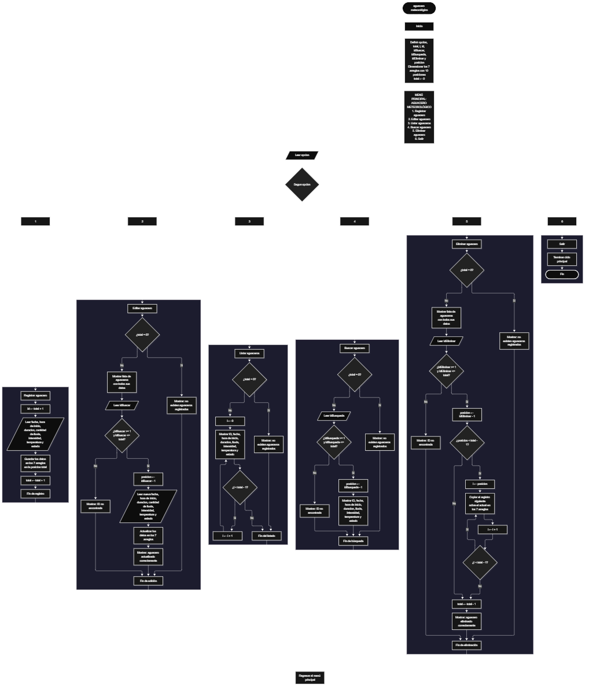

Este proyecto, llamado <b>aguacero meteorológico</b>, fue desarrollado en <b>java</b> como un ejercicio práctico para fortalecer la lógica de programación mediante la creación de un sistema de gestión de aguaceros desde la consola. El programa cuenta con un menú principal de seis opciones que permite <b>registrar, editar, listar, buscar y eliminar</b> los aguaceros almacenados. Cada aguacero almacena datos como la fecha, la hora de inicio, la duración en minutos, la cantidad de lluvia en milímetros, la intensidad, la temperatura registrada y el estado del evento, utilizando arreglos con una capacidad de <b>10 aguaceros durante la ejecución</b>. Durante su desarrollo se aplicaron conceptos fundamentales de programación, como variables, arreglos de distintos tipos de datos, estructuras condicionales, ciclos repetitivos y estructuras de selección, además de procesos para modificar, eliminar y reorganizar registros. Este proyecto permite poner en práctica los conocimientos adquiridos en java y sirve como base para desarrollar sistemas de gestión más avanzados utilizando otros lenguajes y tecnologías.

<h2 align="center">⚙️ Funcionamiento del menú principal</h2>

### ➕ Registrar aguacero

La opción <b>1) registrar aguacero</b> permite añadir un nuevo aguacero al sistema. Al seleccionarla, el programa calcula el identificador del aguacero mediante la expresión <b>total + 1</b> y lo muestra en pantalla. Después, solicita la <b>fecha, la hora de inicio, la duración en minutos, la cantidad de lluvia en milímetros, la intensidad de la lluvia, la temperatura registrada y el estado del evento</b>, y guarda cada dato en la posición <b>total</b> de su respectivo arreglo. Los datos numéricos se leen con <b>nextInt()</b> y <b>nextDouble()</b>, y se utiliza <b>nextLine()</b> para limpiar el salto de línea antes de leer texto. Finalmente, muestra el mensaje <b>"Aguacero registrado correctamente."</b> y aumenta la variable <b>total</b> en uno.

### ✏️ Editar aguacero

La opción <b>2) editar aguacero</b> permite modificar la información de un aguacero registrado. Primero, el programa comprueba si existen aguaceros almacenados mediante la variable <b>total</b>. Si no hay registros, muestra el mensaje <b>"No existen aguaceros registrados."</b>. En caso contrario, presenta una lista con el ID, la fecha, la hora de inicio, la duración, la lluvia, la intensidad, la temperatura y el estado de cada aguacero. Después, solicita el ID del aguacero que se desea editar y comprueba que esté dentro del rango permitido mediante la condición <b>idBuscar &gt;= 1 y idBuscar &lt;= total</b>. Si la selección es válida, calcula la posición con <b>idBuscar - 1</b>, solicita los nuevos datos del aguacero y actualiza directamente los valores de los arreglos correspondientes. Finalmente, presenta el mensaje <b>"Aguacero actualizado correctamente."</b>. Si el ID no corresponde a un aguacero registrado, muestra el mensaje <b>"ID no encontrada."</b>.

### 📋 Listar aguaceros

La opción <b>3) listar aguaceros</b> permite visualizar todos los aguaceros registrados actualmente. Antes de mostrar la información, el programa comprueba si la variable <b>total</b> es igual a cero. Si no existen registros, presenta el mensaje <b>"No existen aguaceros registrados."</b>. Si hay aguaceros disponibles, muestra el título <b>"Lista de aguaceros"</b> y utiliza un ciclo <b>for</b> para recorrer los arreglos desde la primera posición hasta el número total de aguaceros registrados. Durante el recorrido, muestra en una sola línea el ID, la fecha, la hora de inicio, la duración, la lluvia, la intensidad, la temperatura y el estado de cada aguacero, acompañando los valores numéricos con sus unidades: minutos, milímetros (mm) y grados Celsius (C).

### 🔎 Buscar aguacero

La opción <b>4) buscar aguacero</b> permite localizar un aguacero mediante su ID. Primero, el programa comprueba si existen aguaceros registrados. Si no hay registros, muestra el mensaje <b>"No existen aguaceros registrados."</b>. En caso contrario, solicita el ID que se desea buscar y verifica que esté dentro del rango válido mediante la condición <b>idBusqueda &gt;= 1 y idBusqueda &lt;= total</b>. Si el ID es válido, calcula la posición con <b>idBusqueda - 1</b> y muestra el mensaje <b>"Datos del aguacero encontrado:"</b> junto con todos los datos del aguacero. Si el ID no corresponde a un aguacero registrado, presenta el mensaje <b>"ID no encontrada."</b>.

### 🗑️ Eliminar aguacero

La opción <b>5) eliminar aguacero</b> permite eliminar un aguacero registrado mediante su ID. Antes de comenzar, el programa comprueba que existan aguaceros almacenados. Si el sistema está vacío, muestra el mensaje <b>"No existen aguaceros registrados."</b>. Si hay registros disponibles, presenta una lista con los datos de cada aguacero. Después, solicita el ID del aguacero que se desea eliminar y verifica que la selección esté dentro del rango válido. Si el aguacero existe, calcula su posición y utiliza un ciclo <b>for</b> que desplaza una posición hacia atrás los datos de los aguaceros posteriores en los siete arreglos. Posteriormente, disminuye la variable <b>total</b> en uno y muestra el mensaje <b>"Aguacero eliminado correctamente."</b>. Si el ID no corresponde a un aguacero registrado, informa mediante el mensaje <b>"ID no encontrada."</b>.

### 🚪 Salir del menú principal

La opción <b>6) salir</b> finaliza la ejecución del programa y muestra el mensaje <b>"Gracias por utilizar Aguacero Meteorologico."</b>. El menú principal se encuentra dentro de una estructura repetitiva <b>do-while</b>, que mantiene el programa en funcionamiento mientras se cumpla la condición <b>opcion != 6</b>. Cuando el usuario selecciona la opción 6, la condición deja de cumplirse, el ciclo termina y el programa cierra el objeto <b>Scanner</b> con <b>entrada.close()</b>.

<h2 align="center">🧠 Temas aplicados en el proyecto</h2>

### 📦 Variables

En este proyecto se utilizan variables para guardar la opción seleccionada en el menú, controlar la cantidad de aguaceros registrados, recorrer los arreglos, calcular el identificador de cada aguacero, almacenar los ID que el usuario desea editar, buscar o eliminar y determinar la posición de cada aguacero dentro de los arreglos. Cada variable cumple una función específica dentro de las operaciones de gestión de aguaceros.

🔢 **opcion:** Almacena la opción seleccionada por el usuario en el menú principal.

📊 **total:** Almacena la cantidad actual de aguaceros registrados y también indica la siguiente posición libre en los arreglos.

🆔 **id:** Almacena el identificador del aguacero que se está registrando, calculado como <b>total + 1</b>.

🔎 **idBuscar:** Almacena el ID del aguacero que se desea editar.

🔍 **idBusqueda:** Almacena el ID del aguacero que se desea buscar.

🗑️ **idEliminar:** Almacena el ID del aguacero que se desea eliminar.

📍 **posicion:** Almacena la posición del aguacero dentro de los arreglos, calculada restando uno al ID.

🔄 **i:** Funciona como contador en los ciclos <b>for</b> que recorren los arreglos.

### 🗃️ Arreglos

En este proyecto se utilizan siete arreglos relacionados con los datos de cada aguacero. Cada arreglo tiene una capacidad de <b>10 posiciones</b> y utiliza el mismo índice para representar la información correspondiente a un mismo aguacero. Cuatro de ellos son de tipo <b>String</b>, uno es de tipo <b>int</b> y dos son de tipo <b>double</b>, según el dato que almacenan. Por ejemplo, los datos de un aguacero almacenado en la posición <b>1</b> se encuentran distribuidos entre <b>fechas[1], horasInicio[1], duraciones[1], lluvias[1], intensidades[1], temperaturas[1] y estados[1]</b>. Esta organización permite recorrer, buscar, modificar, mostrar y eliminar los aguaceros de manera ordenada.

📅 **fechas[10]:** Almacena la fecha de cada aguacero.

🕐 **horasInicio[10]:** Almacena la hora de inicio de cada aguacero.

⏱️ **duraciones[10]:** Almacena la duración en minutos como número entero.

🌧️ **lluvias[10]:** Almacena la cantidad de lluvia en milímetros como número decimal.

💨 **intensidades[10]:** Almacena la intensidad de la lluvia.

🌡️ **temperaturas[10]:** Almacena la temperatura registrada como número decimal.

📌 **estados[10]:** Almacena el estado de cada evento.

### 🔀 Estructuras condicionales

En este proyecto se utilizan las estructuras <b>if</b> y <b>else</b> para verificar si existen aguaceros registrados antes de realizar determinadas operaciones, validar el ID seleccionado para editar, buscar o eliminar un aguacero y decidir si se muestra la lista de aguaceros o el mensaje de que no existen registros. Estas condiciones permiten que el programa responda de manera diferente según el estado del sistema y el resultado de cada operación.

### 🔄 Estructuras repetitivas

En este proyecto se utilizan los ciclos <b>for</b> y <b>do-while</b>. Los ciclos <b>for</b> permiten recorrer los arreglos para mostrar los aguaceros en las listas de editar, listar y eliminar. Durante la eliminación, también se utiliza un ciclo <b>for</b> para desplazar los datos de los aguaceros posteriores una posición hacia atrás. Por otro lado, el ciclo <b>do-while</b> mantiene activo el menú principal para que el usuario pueda ejecutar diferentes operaciones antes de salir del programa.

### 🎯 Estructura switch

El programa evalúa el valor almacenado en la variable <b>opcion</b> y ejecuta el bloque de instrucciones correspondiente. Cada caso representa una operación específica del sistema: <b>registrar, editar, listar, buscar, eliminar o salir</b>. Cada bloque finaliza con la instrucción <b>break</b>. También se utiliza el bloque <b>default</b> para mostrar el mensaje <b>"Opcion no valida."</b> cuando el valor introducido no coincide con ninguna de las opciones definidas.

### 🔢 Declaración de arreglos

El programa declara cuatro arreglos mediante la instrucción <b>new String[10]</b>, uno mediante <b>new int[10]</b> y dos mediante <b>new double[10]</b>, lo que establece la capacidad de cada uno en <b>10 posiciones</b>. Esto permite administrar hasta 10 aguaceros durante la ejecución. La cantidad de posiciones ocupadas se controla mediante la variable <b>total</b>, por lo que las operaciones recorren únicamente los registros comprendidos entre la primera posición y el total actual de aguaceros.

### 🔄 Reorganización de registros

Cuando se selecciona un aguacero para eliminarlo, el programa utiliza un ciclo <b>for</b> que comienza en la posición seleccionada y llega hasta <b>total - 1</b>. En cada repetición, los datos de la posición siguiente se copian sobre la posición actual en los siete arreglos: <b>fechas, horasInicio, duraciones, lluvias, intensidades, temperaturas y estados</b>. Después, la variable <b>total</b> disminuye en uno, por lo que la última posición queda fuera del rango de registros activos. De esta manera, los aguaceros posteriores ocupan las posiciones disponibles sin dejar espacios vacíos entre los registros activos.

<h2 align="center">¿Cómo se implementaron las operaciones crud en el proyecto?</h2>

Las operaciones <b>crud</b> se implementaron mediante las opciones del menú principal, permitiendo administrar los aguaceros registrados. La operación <b>crear</b> corresponde a <b>registrar aguacero</b>, donde se introducen los datos de un nuevo aguacero; <b>leer</b> se realiza mediante las opciones <b>listar aguaceros y buscar aguacero</b>; <b>actualizar</b> corresponde a <b>editar aguacero</b>, donde se modifican los datos de un aguacero registrado; y <b>eliminar</b> se realiza mediante la opción <b>eliminar aguacero</b>. Estas operaciones utilizan variables, arreglos, condicionales y ciclos para gestionar la información almacenada temporalmente durante la ejecución del programa.

<h2 align="center">Diagrama de flujo del proyecto</h2>

<h2 align="center">🛡️ Validaciones del programa</h2>

### 📭 No existen aguaceros registrados

Esta validación se utiliza en las opciones de <b>editar, listar, buscar y eliminar</b>. El programa comprueba si la variable <b>total</b> es igual a <b>0</b> y, si no existen aguaceros registrados, muestra el mensaje <b>"No existen aguaceros registrados."</b>. Esta comprobación evita continuar con las operaciones que necesitan información almacenada cuando el sistema está vacío.

### 🔢 Selección de aguaceros

El programa utiliza las variables <b>idBuscar</b>, <b>idBusqueda</b> e <b>idEliminar</b> para identificar el aguacero que se desea editar, buscar o eliminar. Antes de realizar estas operaciones, comprueba que el número introducido sea mayor o igual a <b>1</b> y menor o igual al valor de <b>total</b>. Si la selección está fuera de ese rango, muestra el mensaje <b>"ID no encontrada."</b>. Esta validación evita modificar, consultar o eliminar posiciones que no corresponden a aguaceros registrados.

### ⚠️ Capacidad máxima de aguaceros

Los arreglos tienen una capacidad de <b>10 posiciones</b>, por lo que el sistema puede almacenar un máximo de 10 aguaceros. Sin embargo, en el código actual la opción de registrar aguacero no comprueba si <b>total</b> ha llegado a ese límite. Por este motivo, al intentar registrar el aguacero número 11 se produce una excepción <b>ArrayIndexOutOfBoundsException</b> y el programa se cierra. Esta situación puede corregirse agregando la condición <b>total &lt; 10</b> antes de solicitar los datos del aguacero.

### ⚠️ Opción inválida

La estructura <b>switch</b> incluye el bloque <b>default</b>, que muestra el mensaje <b>"Opcion no valida."</b> cuando el usuario introduce un número que no corresponde a ninguna de las opciones definidas en el menú. Sin embargo, el programa lee la opción, los ID, la duración, la lluvia y la temperatura con <b>nextInt()</b> y <b>nextDouble()</b>, por lo que si el usuario escribe un texto en lugar de un número, se produce una excepción <b>InputMismatchException</b> y el programa se cierra. Además, <b>nextDouble()</b> utiliza el separador decimal de la configuración regional del sistema, por lo que escribir un decimal con punto, como la cantidad de lluvia o la temperatura, puede producir el mismo error en equipos que usan la coma. Estas situaciones pueden corregirse validando la entrada con <b>hasNextInt()</b> y <b>hasNextDouble()</b>, y fijando la configuración regional del <b>Scanner</b>.

<h2 align="center">🎯 Objetivo del proyecto</h2>

El objetivo principal de este proyecto es fortalecer la <b>lógica de programación</b> mediante el desarrollo de un sistema de gestión de aguaceros en <b>java</b>. A través de su construcción se busca aplicar los conocimientos adquiridos sobre variables, arreglos, estructuras condicionales, ciclos repetitivos y estructuras de selección, integrándolos para resolver un problema de manera organizada. Además, el proyecto permite comprender cómo registrar, consultar, modificar y eliminar información en una aplicación de consola, estableciendo una base para desarrollar sistemas de gestión más completos con otros lenguajes y tecnologías.

